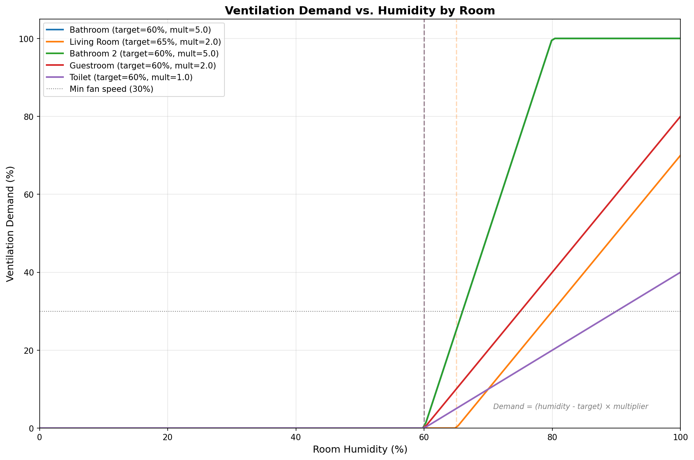

# Home Assistant Ventilation Controller

Humidity-based control for a demand-driven ventilation system with a central fan and a motorized valve per room. Every run it reads the humidity per room from Home Assistant, calculates how much each room needs, and sets the fan speed and valve positions accordingly.

Designed to run once a minute as a Kubernetes CronJob, but `python main.py` works anywhere that can reach Home Assistant.

## Quick Start

```bash
mise trust && mise install           # Python 3.14 + venv
pip install -r requirements.txt
echo "HA_TOKEN=your_long_lived_access_token" > .env

# Edit config.yaml with your Home Assistant URL and entity IDs, then:
python main.py
```

## How It Works

### Demand per room
Each room's demand is how far its humidity is above target, scaled by a per-room multiplier:
```
demand = max(0, (humidity - target_humidity) * multiplier)
```

A higher multiplier responds more aggressively (e.g. bathroom: 5.0, living room: 2.0). Demand has no upper limit; it is used to divide airflow between rooms.

### Outside air adjustment
Ventilation can't dry a room below the humidity outside air has once it is heated to room temperature. In a mild, wet autumn (15°C / 90% outside) that is ~66% RH at 20°C, so a 55% target would keep the fan at 100% indefinitely. Each room's target is therefore raised when needed:
```
reachable = outside_rh * es(outside_temp) / es(room_temp)    # es = Magnus formula
target    = max(target_humidity, min(reachable + margin, max_target_humidity))
```

Outside temperature and humidity come from a weather entity, room temperature from the room's `temperature_sensor`. In cold weather `reachable` is low and the configured target applies as usual. If any value is unavailable, the configured target is used.

### Fan speed
The fan speed is the sum of all room demands, between `minimum_fan_speed` and 100%:
```
fan_speed = min(100, max(minimum_fan_speed, sum(demands)))
```

### Valve positions
Valves open relative to the room with the highest demand, which opens fully. A room that would end up below its `min_opening` gets its `restricted_opening` instead, so the air goes where it's needed. When no room has demand, all valves stay at `min_opening`.

Example while showering:

| Room | Demand | Valve |
|---|---|---|
| Bathroom | 150 | 100% |
| Bathroom 2 | 22 | 10% (22/150 = 15%) |
| Living room | 5 | 0% (3% < `min_opening`, so `restricted_opening`) |

Fan speed and valve positions are rounded to 10% to avoid constant small adjustments, and Home Assistant is only called when a value changes.

### Automatic ventilation switch
The controller only makes changes while the configured `input_boolean` is on. Turn it off to control the ventilation manually.

## Configuration

All settings live in `config.yaml`; the Home Assistant token is read from the `HA_TOKEN` environment variable.

```yaml
global:
  homeassistant:
    url: "http://homeassistant.local:8123"
  automatic_ventilation_switch: "input_boolean.automatic_ventilation"
  ventilation_speed_entity: "fan.ventilation"
  minimum_fan_speed: 30
  outside_weather_entity: "weather.forecast_home"  # Optional
  outside_humidity_margin: 5                       # Optional, default 5
  max_target_humidity: 80                          # Optional, default 80

rooms:
  bathroom:
    humidity_sensor: "sensor.bathroom_humidity"
    temperature_sensor: "sensor.bathroom_temperature"  # Optional
    valve_entity: "valve.bathroom"
    humidity_curve:
      target_humidity: 60
      multiplier: 5.0
    valve:
      min_opening: 10
      restricted_opening: 0
```

Add a room by adding an entry under `rooms`; no code changes needed.

### Home Assistant entities

| Entity | Used for |
|---|---|
| `fan` with a `percentage` attribute | Global fan speed (`fan.turn_on`) |
| `valve` per room with `current_position` | Valve position (`valve.set_valve_position`) |
| `sensor` per room (humidity, optionally temperature) | Demand calculation |
| `weather` with `temperature` and `humidity` attributes | Outside air adjustment |
| `input_boolean` | Automatic ventilation on/off |

## Deployment

The Docker image only contains the Python dependencies; the code and `config.yaml` are mounted at `/scripts`, so changes don't need a new image.

```bash
docker build --platform=linux/amd64 -t <registry>/ventilation-controller:$(date +%Y%m%d) .
docker push <registry>/ventilation-controller:$(date +%Y%m%d)
```

Example with Kustomize:

```yaml
# kustomization.yaml
configMapGenerator:
  - name: ventilation-control-scripts
    files:
      - config.py
      - config.yaml
      - controller.py
      - ha.py
      - main.py
```

```yaml
# cronjob.yaml
apiVersion: batch/v1
kind: CronJob
metadata:
  name: ventilation-control
spec:
  schedule: "* * * * *"
  jobTemplate:
    spec:
      template:
        spec:
          containers:
            - name: ventilation-control
              image: <registry>/ventilation-controller:YYYYMMDD
              workingDir: /scripts
              command: ["python", "main.py"]
              volumeMounts:
                - name: scripts
                  mountPath: /scripts
              env:
                - name: HA_TOKEN
                  valueFrom:
                    secretKeyRef:
                      name: ha-token
                      key: HA_TOKEN
          volumes:
            - name: scripts
              configMap:
                name: ventilation-control-scripts
          restartPolicy: Never
```

## Logging

Each run prints a summary to stdout: the outside conditions, and per room the humidity, temperature, (raised) target, demand and valve change. Set `OTEL_EXPORTER_OTLP_ENDPOINT` to also send the `logging` output (start/finish of each run) to an OpenTelemetry collector.

## Demand curves

`visualize_demand.py` plots each room's demand curve from `config.yaml` to `demand_curves.png` (requires `matplotlib` and `numpy`).


